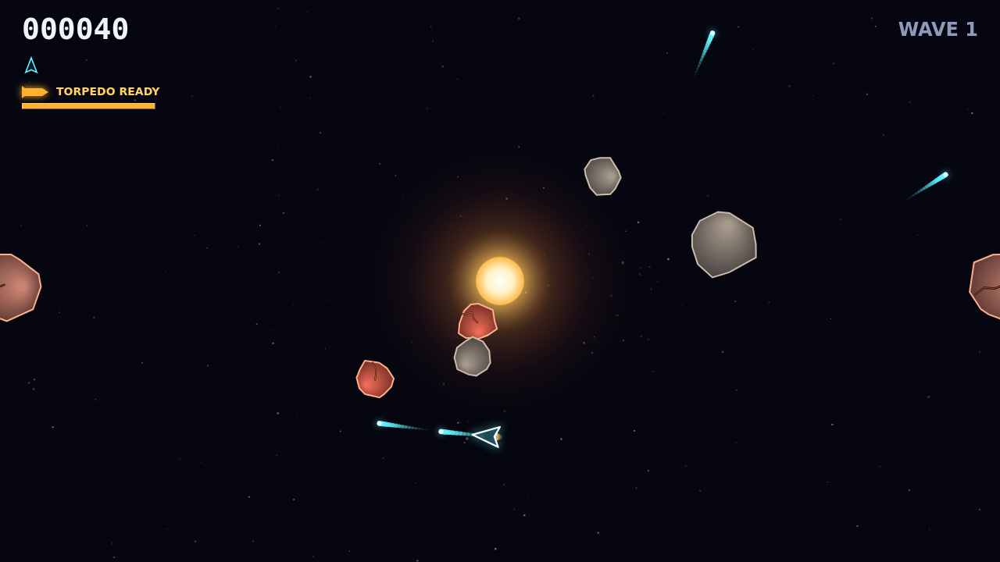

# Shatter

Shatter is a fast, tense rock shooter played on one wrapping field of deep
space, with a burning star fixed at its centre. You fly a small ship on pure
momentum, turning and thrusting while jagged rocks tumble around you, and you
shoot them apart: a Large breaks into two Mediums, each Medium into two Smalls,
and the Smalls wink out for the biggest payout of all.

The star is the whole game. Its gravity pulls on every bullet and every rock but
never on your ship, so you always fly exactly where you steer while the board
around you bends. Shots curve as they cross the centre, which means a rock
hiding on the far side of the star is still in reach if you aim around it. Rocks
fall toward the well on long, swinging paths, and any rock the core swallows
comes tumbling back in from the edge of the field, so the star stirs the board
without ever clearing it for you.

A wave is fought rock by rock. The bigger rocks are armored: a Large takes three
hits and a Medium two, and each hit leaves a rock visibly cracked and glowing, so
you can see how close it is to breaking. When one will not come apart in time,
you have a single guided torpedo on a ten-second recharge. It locks onto the
nearest target in a narrow cone ahead of you, flies straight through the well
without bending, and destroys any rock outright.

Clear the field and a bigger, faster wave rolls in. Every so often a saucer
glides in to hunt you, weaving as it fires; shoot it down for a fat bonus. Every
10,000 points earns another ship, and you will need it.
